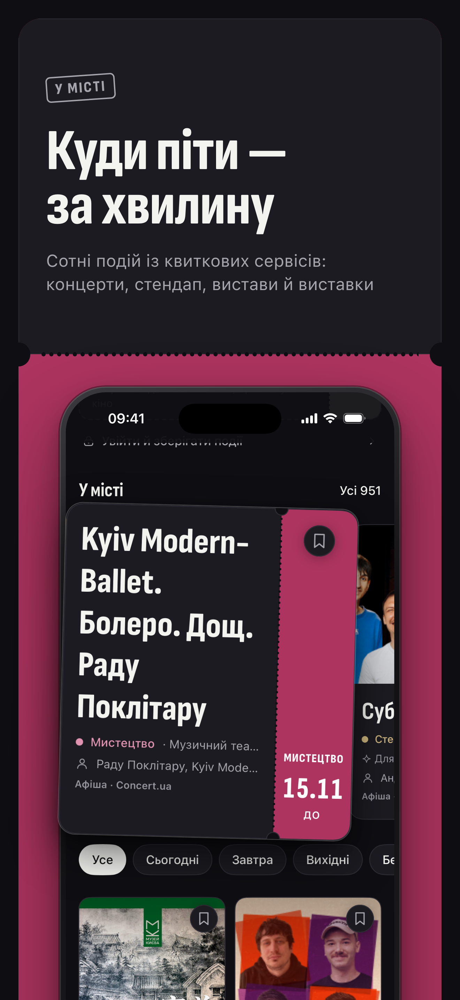
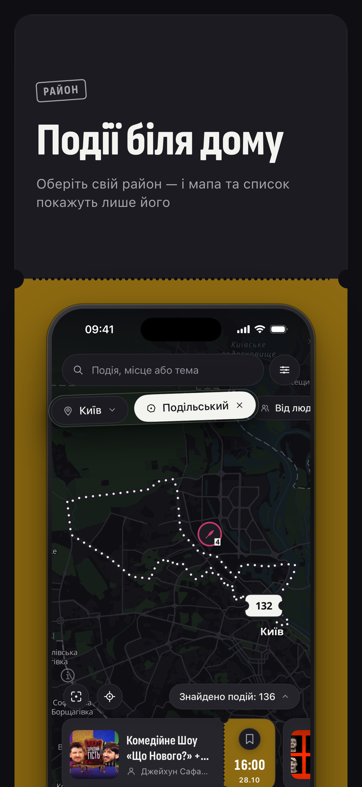

<p align="center">
  
</p>

<h1 align="center">Поряд</h1>

<p align="center">
  <b>Є куди. Буде з ким.</b><br>
  Афіша Києва, Львова, Одеси, Дніпра й Харкова на одній мапі — і компанія, з якою піти.
</p>

<p align="center">
  <a href="https://apps.apple.com/app/apple-store/id6813543772?pt=129478154&ct=github&mt=8"></a>
  <a href="https://play.google.com/store/apps/details?id=app.poriad.android&referrer=utm_source%3Dgithub"></a>
</p>

<p align="center">
  <a href="https://poriad.app">poriad.app</a> · <a href="https://poriad.app/afisha.html">веб-афіша</a>
</p>

<p align="center">
  
  
  
  
</p>

## Навіщо

Пʼятниця, вечір. Сорок хвилин гортаєш Telegram-канали з афішею — і лишаєшся вдома. Бо нема куди, а якщо є куди, то нема з ким.

«Поряд» збирає події міста на одну мапу: афішу з відкритих джерел і зустрічі, які створюють люди. За хвилину знаходиш, куди піти сьогодні чи на вихідних, бажано недалеко. А якщо квиток є, а компанії нема, — знаходиш і її.

## Що вміє

- **Афіша на мапі.** Концерти, вистави, стендап, виставки, екскурсії й зустрічі від людей в одному місці. Фільтри «Сьогодні», «Завтра», «Вихідні», пошук за подією, місцем або артистом. Сеанси, що вже почались, у видачу не потрапляють.
- **«Шукаю компанію».** Одна кнопка на будь-якій афіші — і «Йдемо разом» збирає від двох до восьми людей на ту саму подію.
- **Зустрічі від людей.** Свою зустріч створюєш за хвилину: опис, точка на мапі, час і кількість місць. Підтвердження учасників, вікові межі й черга: місце, що звільнилось, дістається першому.
- **«Стежити».** За закладом, організатором чи артистом — і першим дізнаєшся про їхні нові події.
- **Головна.** «Ваше» — найближчі плани, чати й запити на участь. «У місті» — що відбувається сьогодні й на вихідних.
- **Безпека без драми.** Найближче укриття біля місця події (поки в Києві) і рядок «до комендантської лишиться N» для вечірніх подій.
- **Усе під рукою.** Посилання `poriad.app/e/…` з превʼю для Telegram, чат події, календар, маршрут у мапах, нагадування за годину до початку й пʼятничний дайджест вихідних.

## Приватність

- Афішу видно без профілю. Вхід через Apple, Google або пошту потрібен лише тоді, коли хочеш приєднатися, зберегти чи створити подію.
- Профіль — з 18 років. Імена учасників бачать лише організатор і самі учасники, решта бачить тільки лічильник. Ці правила виконує база, а не застосунок.
- Без реклами й рекламних ідентифікаторів. Геолокація лише приблизна, і без дозволу застосунок теж працює. Аналітику можна вимкнути в профілі.
- Квитків «Поряд» не продає: на афішну подію веде посилання на сайт організатора.

## Як це зроблено

Спільна логіка написана на Kotlin Multiplatform, інтерфейси нативні: SwiftUI на iOS (від 17) і Jetpack Compose на Android (від 8.0), з однією дизайн-системою на обох платформах. Бекенд — Supabase: PostgreSQL з PostGIS, правила доступу в RLS, пуші через edge-функції. Мапа — MapLibre з тайлами OpenFreeMap. Афішу щодня збирає конвеєр імпорту: зводить дублі з різних джерел, геокодує майданчики й розпізнає артистів.

| Тека | Що там |
| --- | --- |
| [`androidApp/`](androidApp/) | Android: Jetpack Compose, Navigation 3, MVI |
| [`iosApp/`](iosApp/) | iOS: SwiftUI, NavigationStack |
| [`shared/`](shared/), [`core/`](core/), [`feature/`](feature/) | спільна логіка: правила, дані, сценарії, кеш SQLDelight |
| [`supabase/`](supabase/) | схема, міграції, RLS, edge-функції, SQL-тести |
| [`tools/ingest/`](tools/ingest/) | імпорт афіші з відкритих джерел |
| [`worker/`](worker/) | Cloudflare Worker для `poriad.app/e/{id}`, Universal Links і App Links |
| [`site/`](site/) | сайт poriad.app: лендинг, веб-афіша, правові сторінки |
| [`store/`](store/) | тексти й графіка для App Store і Google Play |
| [`marketing/`](marketing/) | рекламні ролики й сценарії |
| [`docs/`](docs/) | специфікації фіч, аудити, дослідження |

## Для розробників

```sh
./gradlew :androidApp:installDevDebug
```

```sh
./gradlew :shared:linkDebugFrameworkIosSimulatorArm64
open iosApp/Poruch.xcodeproj
```

- [docs/development.md](docs/development.md) — збірка Android та iOS, середовища dev і prod, архітектура, логи, перевірки.
- [PRODUCT.md](PRODUCT.md) — для кого продукт, позиціонування, принципи.
- [DESIGN.md](DESIGN.md) — візуальна система «Корінець».
- [iosApp](iosApp/README.md) · [Supabase](supabase/README.md) · [імпорт](tools/ingest/README.md) · [сайт](site/README.md) · [worker](worker/README.md)

---

Публічна назва — «Поряд» (латиницею Poriad), кодова в репозиторії — Poruch. Мапа: MapLibre, дані © учасники OpenStreetMap, тайли OpenFreeMap. Контакт: hello@poriad.app · [Політика конфіденційності](https://poriad.app/privacy.html)
